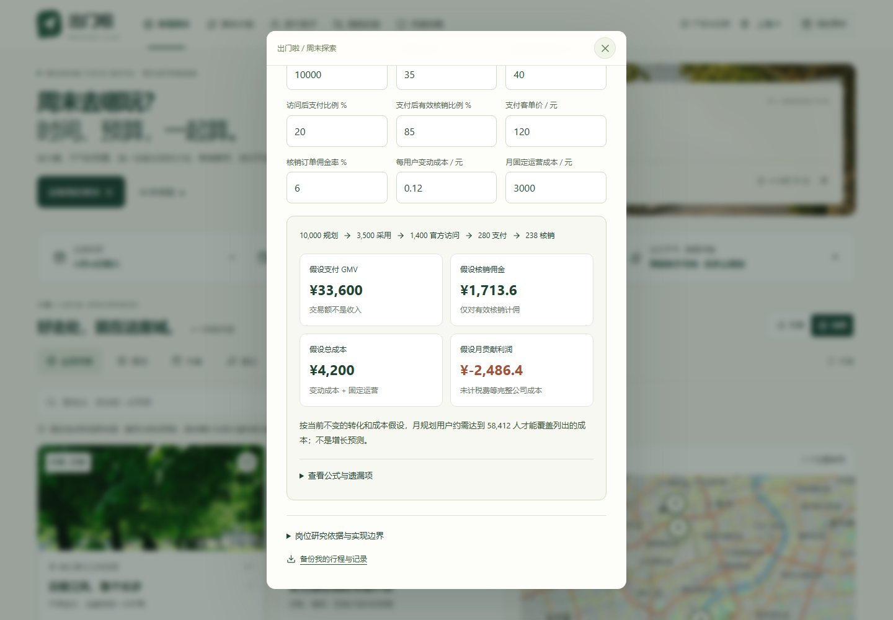

# 出门啦 · 周末城市探索指南

**[打开公开作品 →](https://leiqingliang.github.io/weekend-city-guide/)**

[](https://github.com/LeiQingliang/weekend-city-guide/actions/workflows/verify-preview.yml)

面向大学生的周末城市探索产品，也是一次 AI Coding 产品设计练习。把“去哪玩”落实成一份能看懂花费、安排时间、邀请朋友、留下回忆的周末计划。

[90 秒体验路线](docs/SHOWCASE.md) · [AI 优先设计](docs/AI-EXPERIENCE.md) · [产品与运营策略](docs/PRODUCT-STRATEGY.md) · [产品设计说明](docs/PRODUCT.md) · [设计依据](docs/DESIGN.md) · [验证记录](docs/VERIFICATION.md)

## V6：先说目标，再把周末一起改好

上海、杭州、北京共 **12 个有来源的真实场馆与城市探索地点**。先说“上海，周六，两个人，人均100元，下午看展，3小时”，再继续说“预算改为80元”“只去室内”。页面整理可编辑条件、展示每轮变化，最多比较两份可行方案；确认采用后，再安排同行、出发和记录。

本页描述 V6 源码中的产品能力；本轮正式构建、浏览器验收与公开发布状态见 [验证记录](docs/VERIFICATION.md)，未记录完成的项目不代表已经上线。固定公开地址保持不变。

点首页 **“90 秒体验”**，可用临时计划走过选择、雨天调整、分享和打卡；退出导览或刷新后回到原有本机记录。

这一轮把规划变成可持续修改的过程：没提到的条件沿用，改错可以撤销，未覆盖的要求需要单独确认。采用后，“出发速览”集中展示每站时间、地址、费用、官方入口与同行操作。“产品与运营”继续解释痛点判断、验证方案与商业假设。

| 环节 | 已实现能力 |
| --- | --- |
| 说目标、逐轮修改 | 整理城市、兴趣、全天预算、人数、日期、首站时间与可用时长；继续输入只改提到的条件，展示差异，支持撤销与手动核对 |
| 少做选择 | 最多比较两份不同组合，说明理由与取舍；只去室内、排除兴趣和未覆盖要求分别处理，采用前不覆盖正式计划 |
| 地点有依据 | 12 个地点附官方或政府来源、核验日期、地址、预约与开放说明；真实街区和未确认的市集、演出场次分别标记 |
| 看清在哪里 | Leaflet 交互地图与列表联动，11 个核对过的 OpenStreetMap 参考点；地图加载失败仍可看列表、重试或打开高德搜索 |
| 算时间与花费 | 时间轴、顺序调整、人均及同行规划总额；各站费用可校正，可用时长随采用、分享和恢复保留，加站超时明确提示 |
| 出发前再核对 | 计划编辑与出发速览可切换；每站时间、地址、费用和官方入口集中展示，清单勾选不等于预约；具体反馈可继续修改 |
| 应对天气变化 | Open-Meteo 城市预报与手动天气情景；雨天定制筛选室内，替代前展示新费用和时间，不可行时说明限制 |
| 邀请朋友同行 | 创建自己的小队、分享邀请；朋友生成参加或撤回回执，手动发回，发起人核对后确认导入名单 |
| 留下并分享经验 | 文字与照片打卡；整理成可编辑攻略草稿，补充实际花费后保存、分享 |
| 带走与保存 | 行程快照预览、复制链接与本地二维码；日历和文字导出，本机记录持久化、JSON 备份及确认恢复 |
| 产品与运营 | 三个视角解释产品判断、运营验证、商业测算；本机操作次数不当作用户规模，假设收入与成本可调，亏损结果如实展示 |

## 界面预览

| 桌面：地点、地图与周末提案 | 手机：随时挑选、带走计划 |
| --- | --- |
|  |  |

以上为本轮实际运行的 V6 首页截图，桌面与手机均经浏览器检查；对应版本的构建和发布证据见 [验证记录](docs/VERIFICATION.md)。

“产品与运营 → 商业测算”将支付交易额、有效核销佣金和成本分开计算，支持修改假设并观察盈亏平衡。下图是实际页面中的演算，**不是项目收入或用户规模**。



## 当前运行模式

<!-- runtime-mode:start -->
公开静态站当前使用本地需求解析与约束规则，并明确标注模式。独立 DeepSeek 接口及前端适配已实现，完成一条本机真实模型调用，验证了语义人数、预算、时长与未覆盖要求，再由规则生成方案；这不等于云后端已部署或公开页面已调用模型。目前没有云后端，页面继续完整提供本地规划。模型接口、安全边界与启用方式见 [后端说明](backend/README.md)，模拟、真实调用与公开验收分别见[验证记录](docs/VERIFICATION.md)。
<!-- runtime-mode:end -->

## 信息如何使用

**真实地点，规划费用。** 地点资料于 2026-11-10 查阅并记录来源，详见 [资料目录](src/evidence.ts)。西岸美术馆、浙江美术馆、UCCA 的已知常规开闭馆和最后入场时间参与计划约束；节假日、临时调整仍需核实。安义路、小河直街是街区探索灵感，不承诺当周有市集；演出场馆没有绑定真实场次。费用分为官方列明免费、活动预留与可选消费，不是实时票价或总价保证。查到价格后，可在计划中校正各站金额，预算和导出同步重算；自行填写不等于票价核验或支付成功。图片表达场景氛围，不作为场馆实拍证据。

**条件可核对，估算有边界。** 运行方式见[当前运行模式](#当前运行模式)。定制不静默放宽预算、时长、雨天或排除项；不安排跨日或当日 22:00 后结束的方案，这是一天出游的产品范围，不是场馆关门时间。同行人数轻量影响偏好排序并计算同行总额，不代表余票或容量。转场统一预留 25 分钟，演出暂按不早于 19:00 占位；餐饮目前计入费用，尚未安排用餐时段，首站前与末站后交通也需另留时间。地图不计算导航路线或交通耗时。

**不能理解的要求不悄悄丢掉。** “少走路”“18点前返校”等尚未纳入约束的条件会保留并提示；用户确认另行核对后才能参考已识别条件的方案。确认不代表这些要求已经满足。草稿支持增量修改和撤销，只有采用才替换正式计划；预订、支付或联系商家不会被伪装成已完成的动作。

**时间限制带进正式计划。** 有效可用时长为 60–720 分钟；采用后继续保留，加站或调整顺序导致超时会提示。日历包含完整规划费用与全部排程警告，冲突安排标记“需调整”；导出不意味着可以按时入场或已经预约。旧计划没有时长上限时仍按未设置处理。

**联网服务有回退。** [Open-Meteo](https://open-meteo.com/en/docs) 提供城市参考位置预报，不读取设备定位；失败或超出预报范围时明确提示。地图采用 [OpenStreetMap](https://www.openstreetmap.org/copyright) 底图，国内网络或服务异常可能导致加载失败，此时保留地点文本及高德搜索入口。无可靠坐标的徐汇滨江仍在列表中展示。

**分享可带走，名单由本人确认。** 行程、邀请、回执和攻略通过链接的 `#` 片段传递；二维码在设备本地生成，不使用外部短链服务，内容过长时退回复制链接。朋友必须自行把回执发回，发起人确认导入后才更新本机名单；没有身份认证、实时同步或自动发消息。链接可转发、内容不加密，本机修改不会撤回已发出的快照。清除浏览器数据前可先备份。

**操作次数与商业假设分开。** 运营页仅记录本机实际操作，不上传、不统计临时导览，不代表 UV、漏斗转化或真实到访。商业模型的规划量、转化、客单价、佣金和成本都是可修改的假设；当前没有合作结算、支付回传或佣金收入。策略依据来自官方公开岗位与实践，不冒充美团笔试评分标准。

出发核对状态和体验计数只保存在当前浏览器，不随分享或既有 JSON 备份迁移；行程、收藏、小队、打卡与攻略仍按原有方式备份恢复。

## 本地运行与检查

Node.js **22.13+**，React + TypeScript + Vite。

```bash
npm ci
npm run dev
```

```bash
npm run typecheck
npm test
npm run build
npm run preview
```

逻辑检查覆盖方案约束与排序、需求解析、预算和开放时段、日历、天气回退、记录恢复及回执导入。实际运行结果见 Actions 与 [验证记录](docs/VERIFICATION.md)；单元测试不替代浏览器交互、手机扫码或公开访问检查。

## 固定地址与发布

源码保留在 `main`，GitHub Actions 执行测试与构建。已验证的生产文件发布到 `gh-pages` 分支根目录，由 GitHub Pages 部署；推送源码后仍须发布对应产物，详见 [发布步骤](docs/DEPLOYMENT.md)。后续迭代继续使用同一地址：

**https://leiqingliang.github.io/weekend-city-guide/**

保留 GitHub 用户名 `LeiQingliang`、仓库名 `weekend-city-guide` 及 Vite `base: "/weekend-city-guide/"`。维护约定见 [AGENTS.md](AGENTS.md)，代码见 [GitHub 仓库](https://github.com/LeiQingliang/weekend-city-guide)。

图片来源见 [credits.txt](public/images/credits.txt)。天气保留 [Open-Meteo / CC BY 4.0](https://open-meteo.com/en/licence) 署名及[接口使用条件](https://open-meteo.com/en/terms)；地图、二维码依赖与设计资料见 [设计依据](docs/DESIGN.md)。
