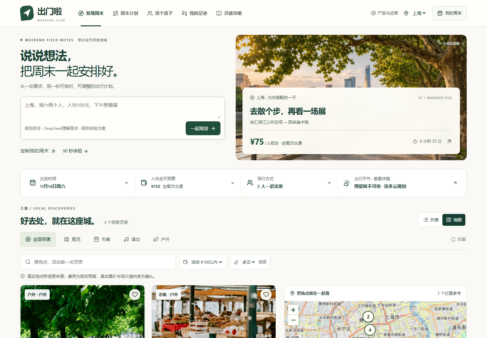
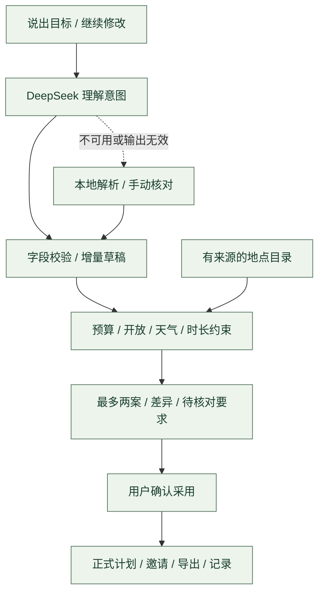
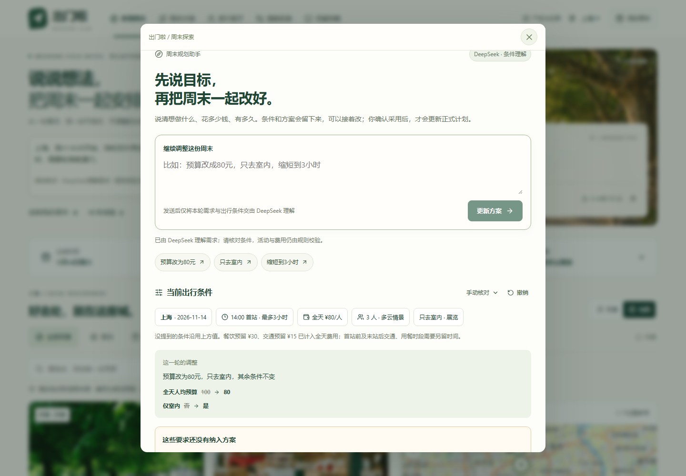

# 出门啦 · 周末城市探索指南

**从“周末去哪玩”，到一份花费清楚、时间可核对、朋友能一起出发的计划。**

### [打开在线作品 ↗](https://leiqingliang.github.io/weekend-city-guide/)

[](https://github.com/LeiQingliang/weekend-city-guide/actions/workflows/verify-preview.yml)

[体验导览](docs/SHOWCASE.md) · [AI 交互设计](docs/AI-EXPERIENCE.md) · [产品与运营策略](docs/PRODUCT-STRATEGY.md) · [验证证据](docs/VERIFICATION.md)

这是面向大学生周末出行的 **AI 优先产品原型**，围绕偏好、天气、预算与同行人数组织本地探索，串起计划、组队、打卡和攻略分享。通过 AI Coding 完成设计、实现、检查与公开部署；产品取舍、信息来源和验证边界均可追溯。

当前覆盖 **上海、杭州、北京，12 个有来源的真实场馆与城市探索地点**。DeepSeek 云端意图理解已接通，支持连续修改同一份计划草稿；真实地点不等于已确认的当周展览、市集或演出场次。当前没有真实用户增长、交易或收入数据。



*2026-11-10 公开站点实测截图。图片中的城市风景为已标注的氛围参考；天气获取失败时展示实际回退状态。*

## 快速体验：从一句话到出发计划

打开作品即可体验，无需登录。首页的 **「90 秒体验」** 使用临时数据，退出或刷新后回到原有本机记录；也可以按下面的顺序自由操作。

| 步骤 | 可以这样操作 | 重点观察 |
| --- | --- | --- |
| 1. 说目标 | 输入「上海，周六14:00，我和另外两位同学一起看展，每人预算100元，含餐饮交通，总共3小时」 | 核对人数、全天预算、日期与时长；条件能手动编辑 |
| 2. 接着改 | 继续输入「预算改为80元，只去室内，其余条件不变」 | 只改变提到的条件，展示前后差异，支持撤销；最多比较两案 |
| 3. 确认出发 | 核对方案后采用，进入「出发速览」，查看每站时间、地址、费用与官方入口 | 草稿在确认前不覆盖正式计划；预约、票价与交通仍需核实 |
| 4. 带朋友去 | 分享计划，在新浏览器打开；创建小队、传回参加回执，再打卡和整理攻略 | 计划可带走，回执需发起人确认，记录可刷新保留 |

还可以补充「需要轮椅能通行」：这类尚未支持的约束会保留为**待核对要求**，不会因为模型回复流畅就被标为已经满足。确认另行核对之后，才可采用按已识别条件生成的方案。

想看产品判断与商业思路，进入页面右上角 **「产品与运营」**，切换「产品判断 / 运营验证 / 商业测算」。

## 产品判断：优先解决不能出发的问题

**核心用户任务：** 当周末有一段空闲、预算有限、想独自或约熟人出门时，快速得到一份自己愿意去、当日可行、朋友能理解的计划。

目标用户是**已有出行意愿、尚未确定目的地的学生及熟人小队**。以下需求与优先级来自题目和场景分析，尚未通过独立用户访谈验证；当前主动收窄范围，不做陌生人撮合、跨城旅游和自动交易。

| 痛点假设 | 产品取舍 | 怎样验证价值 |
| --- | --- | --- |
| 信息分散，收藏之后还要反复查地址、开放与预约 | 将来源、查阅日期、开放说明与未知项放进同一计划 | 观察核对步骤、信息误解和因资料失效而返工的次数 |
| 单项看似便宜，算上吃饭和交通就超预算 | 统一全天费用口径，各站金额可校正，计算同行规划总额 | 检查用户能否解释费用构成，是否把预留误认为保证票价 |
| 天气变了、出发晚了，原来的选择无法执行 | 已知开放时段、预算、雨天和可用时长参与筛选；无解时说明限制 | 以任务完成和硬约束冲突判断，不以推荐条数判断 |
| 选项越刷越多，朋友还没有明确答复 | 最多两案比较；用共享计划、集合信息与确认回执衔接同行 | 对照惯用方式观察决策耗时、追问次数和放弃原因 |

先保证「能理解、能核对、能决定」，再考虑扩充供给与增长。具体反证条件、拟议访谈及试验方案见 [产品与运营策略](docs/PRODUCT-STRATEGY.md)。

## AI 优先：围绕一份可修改、可确认的计划

自然语言是入口，**结构化计划是持续操作的对象**。用户可以说、改、比较、撤销，最终在同一份计划里完成出发准备；对话不会停留在一段需要自行搬运的攻略文字。



| 分工 | 当前实现 | 关键边界 |
| --- | --- | --- |
| 模型理解 | 将本轮文字与当前出行条件整理为结构化修改建议 | 不生成地点目录、票价或场次事实，不代替用户订票、付款或联系商家 |
| 规则核对 | 校验字段，合并草稿，从有来源的目录生成方案并检查已知约束 | 不静默放宽硬条件；无法覆盖的要求持续保留，确认待核对不等于满足 |
| 用户决定 | 看差异、手动修正、撤销、比较、确认采用 | 没提到的条件沿用；非法修改整轮拒绝；关闭草稿保留原计划 |

这一分工让 AI 承担开放表达的理解任务，把费用、时间和状态变化留在可检查的流程里。**是否优于本地规则基线，仍须用真实任务完成率、修正次数、延迟与成本验证。** 两次成功调用不能证明总体理解准确率。

<details>
<summary>查看真实在线交互：连续修改与条件差异</summary>



该截图来自两轮真实云端调用的浏览器验收。下方未覆盖要求继续保留，需要单独核对；完整过程见 [验证记录](docs/VERIFICATION.md)。

</details>

## 当前运行模式

<!-- runtime-mode:start -->
独立 DeepSeek 云接口已部署到 Railway，固定 GitHub Pages 前端已接通。2026-11-10 已通过两轮公开页面真实模型调用、连续修改、分享恢复与模拟故障回退验收。界面按实际请求状态区分在线模型和本地规则；网络、额度或输出校验失败时明确回退，仍可手动核对。模型仅整理条件修改建议，方案继续由有来源的地点目录和约束规则生成，用户确认后才采用。接口说明见 [后端文档](backend/README.md)，不同验证层级见 [验证记录](docs/VERIFICATION.md)。
<!-- runtime-mode:end -->

在线理解会将**本轮文字和当前结构化出行条件**发送至 DeepSeek；历史未覆盖要求由页面继续保留。密钥仅保存在服务端。持续在线依赖云服务额度、模型余额及服务限制，不承诺永久免费或永不间断。

## 完整旅程：发现 → 计划 → 同行 → 记录 → 分享

| 题目要求 | 已实现的体验 | 使用边界 |
| --- | --- | --- |
| 按偏好、天气、预算推荐 | 三城地点目录、兴趣与室内筛选、最多两案、全天预算、Open-Meteo 预报、雨天替代预览 | 费用为规划预留，预报失败可选手动情景；没有实时票务库存 |
| 把选择变成可用计划 | 地图与列表联动、顺序调整、开放冲突提示、时长检查、出发速览、各站官方入口 | 地图提供位置参考；当前转场统一预留25分钟，不计算真实导航 |
| 组队出发 | 创建小队、分享集合信息、朋友生成参加或撤回回执、发起人确认导入 | 手动传递，不验证身份，不实时同步或自动发送消息 |
| 打卡记录 | 文字与照片打卡，补充实际花费，刷新后保留 | 记录存于当前浏览器，无跨设备账号同步 |
| 攻略分享 | 从打卡整理可编辑攻略草稿；行程、邀请、回执和攻略可用链接分享 | 快照可转发且不加密，本机更新不撤回已发链接 |
| 出发与保存 | 本地二维码、文字与日历导出、JSON 备份及确认恢复 | 导出不表示预约成功；出发核对状态和体验计数不随既有备份迁移 |

<details>
<summary>查看手机端出发速览</summary>

<p align="center">
  
</p>

截图来自独立手机尺寸浏览器：打开分享链接、载入计划并刷新后，人数、预算与时长继续保留。浏览器模拟检查不等于已完成真实手机扫码验证。

</details>

## 商业化与运营：先证明价值，再验证收入

**当前状态：免费原型，没有合作结算、广告收入、支付回传或佣金收入。** 页面中的「商业测算」是可调假设模型，「运营验证」是本机操作记录，两者不混用。

### 谁可能付费，为什么付费

| 候选路径 | 付费方与价值 | 开始验证的前提 |
| --- | --- | --- |
| 授权的效果导流 | 场所、主办方或授权合作方，为可归因的有效订单或到访付费 | 先有用户价值，再取得合作授权，明确归因、退款、核销与结算规则；普通外链点击不能当收入 |
| 供给方运营工具 | 高频维护活动资料的组织者，为发布、更新提醒与效果复盘付费 | 先用人工服务验证重复劳动和付费意愿，再决定是否软件化 |

学生使用频率和价格敏感度尚待验证，当前不把 C 端订阅作为主要收入路径。未来付费展示必须标明，商业出价不能越过预算、天气和开放约束。

### 算清每个环节，而不是用交易额代替收入

交互模型采用同一批规划用户的连续漏斗，各级比例以前一级为分母，暂按每人每月最多一笔示意订单计算：

```text
规划用户 → 采用计划 → 访问官方 → 支付 → 有效核销
佣金收入 = 有效核销订单 × 支付客单价 × 佣金率
月贡献利润 = 佣金收入 − 全部规划用户的变动成本 − 月固定运营成本
```

**以下仅为页面默认假设的演算，不是真实经营结果：**

| 输入假设 | 演算结果 |
| --- | --- |
| 月规划用户10,000；采用率35%；采用后官方访问率40%；访问后支付率20%；支付后有效核销率85% | 支付280单，有效核销238单 |
| 支付客单价¥120；有效核销订单佣金率6% | 支付交易额¥33,600；佣金收入¥1,713.60 |
| 每名规划用户变动成本¥0.12；月固定运营成本¥3,000 | 月贡献利润 **−¥2,486.40** |

默认情景仍然亏损，因此下一步需要验证转化、归因和成本，不能只讨论扩大流量。若调整后单位贡献不大于零，页面不显示有限的盈亏平衡人数。当前模型未完整处理复购、税费、研发与结算账期；不是 LTV 或经营预测。计算口径可对照 [商业模型](src/business.ts) 与 [对应测试](src/business.test.ts)。

<details>
<summary>查看可交互的商业假设测算界面</summary>


</details>

### 用什么判断产品值得继续做

**拟议北极星：每周完成有效出行并确认体验的用户数。** 指用户在计划日期后主动确认已出发，且认为计划有帮助；未来有获同意的用户标识后按人按周去重。自报不等于位置核验，需同时报告回访响应率，不能把没有回复当成没有出行。

- **任务漏斗：** 提交有效需求 → 看见可行方案 → 采用 → 核对出发 → 自报出行 → 反馈有帮助。同行确认作为多人计划的分支，单人不进入该分母。
- **体验护栏：** 已知硬约束冲突、费用误解、资料失效、任务耗时与放弃原因；AI 另看需修正比例、失败回退与每次有效任务成本。
- **运营起点：** 拟在一个高校通勤圈验证供给，优先补低预算与雨天室内方案；周中复核、周五核验临时变化、周末接收纠错、出行后自愿回访。
- **增长假设：** 可复用计划带来熟人邀请，实际打卡形成攻略，再帮助下一次决策。需要观察真实复用，不把生成分享当作已经发出或带来新用户。

这些是**待实施的测量与试点方案**。当前本机只记录采用、分享、官方入口、建队、打卡、攻略等操作次数及反馈原因，不上传、不计临时导览；重复操作会重复计数，不能据此计算全站 UV、漏斗转化或真实到访。

## 验证证据与当前边界

### 已经验证到哪一层

| 层级 | 已有证据 | 能支持的结论 |
| --- | --- | --- |
| 代码与构建 | [发布源码 f9a6700](https://github.com/LeiQingliang/weekend-city-guide/tree/f9a670029c5f713f0a93eaf962f4d26378de2a9f)；[Actions 运行](https://github.com/LeiQingliang/weekend-city-guide/actions/runs/42764189257)：111项前端逻辑检查、12项后端模拟检查及类型检查、生产构建通过 | 覆盖已编写的契约与边界，不代表用户效果或模型准确率 |
| 公开部署 | [Pages 发布运行](https://github.com/LeiQingliang/weekend-city-guide/actions/runs/42764894893)，固定链接可公开访问 | 已部署的作品可以打开，不把本地预览当交付 |
| 真实在线链路 | 2026-11-10 公开页面两轮 DeepSeek 调用，检查连续修改、未知要求保留与确认采用 | 所记录案例真实走通；不外推为所有输入正确、延迟保证或 SLA |
| 浏览器体验 | 桌面及320/390宽度检查；独立浏览器分享恢复；模拟503故障后本地回退；验收过程未见页面脚本错误 | 覆盖所列场景；模拟故障、真实调用、真实手机扫码分别记录 |
| 用户与商业效果 | 尚无独立访谈、实际试点、全站分析、授权交易回传 | 所有增长、转化与收入仍是待验证假设 |

上述是2026-11-10的发布验收快照，不是持续可用性监控。完整案例、失败边界和版本记录见 [VERIFICATION.md](docs/VERIFICATION.md)；上方徽章展示源码分支的最新检查，不自动等同于当前 Pages 发布版本。

### 使用前应当知道

- **地点、价格与场次：** 12个地点保留来源、查阅日期和未知状态。街区不承诺当周有市集，演出场馆不等于已确认场次；规划金额可校正，但不代表实时票价或已支付。资料见 [evidence.ts](src/evidence.ts)。
- **时间与路线：** 只安排所选日期内、不晚于22:00结束的定制方案；这是产品范围，不是场馆关门时间。已知开放规则参与校验；转场预留25分钟，未确认演出暂以19:00作为规划占位。餐饮只计费用，未排用餐时间及首末站外交通；地图不计算真实路线。
- **数据与分享：** 收藏、计划、小队、打卡和攻略保存在当前浏览器，可备份。分享内容通过链接的 `#` 片段携带，不加密、可转发、无访问认证；二维码在本地生成。清除浏览器数据前应先备份。
- **联网与额度：** 天气与地图有失败提示和替代入口。意图服务当前每进程每日100次、连接来源IP每小时10次、并发2个；重启可重置，代理可能共享额度。CORS不是身份认证，不能视为完整防滥用或生产服务保障，详见 [接口与限制](backend/README.md)。

## 运行、维护与继续迭代

React + TypeScript + Vite 构建前端，Node.js 提供独立意图接口；Leaflet / OpenStreetMap 用于位置参考，Open-Meteo 用于天气，二维码在浏览器本地生成。

<details>
<summary>本地运行与检查</summary>

需要 **Node.js 22.13+**。

```bash
npm ci
npm run dev
```

不配置模型接口也可使用本地规划。联调在线意图理解时，由运行环境安全注入服务端 `DEEPSEEK_API_KEY`，另启后端：

```bash
node backend/server.mjs
```

前端配置 `VITE_INTENT_API_URL=http://127.0.0.1:8787/api/intent`，通过 `127.0.0.1` 打开开发页面以匹配允许来源。**不要把模型密钥放入任何 `VITE_` 变量、仓库文件或前端存储。** 更多配置见 [backend/README.md](backend/README.md)。

```bash
npm run typecheck
npm test
npm run test:backend
npm run build
npm run preview
```

若 Windows 系统策略阻止原生构建依赖，保留错误信息并使用仓库 Linux CI；不关闭或绕过系统策略。自动检查通过之后，交互、分享和公开访问仍需单独验收。

</details>

<details>
<summary>实现入口与固定发布方式</summary>

| 关注点 | 代码入口 |
| --- | --- |
| 意图、修改与确认 | [IntentPlanner.tsx](src/components/IntentPlanner.tsx)、[intent.ts](src/intent.ts)、[intentGateway.ts](src/intentGateway.ts) |
| 有来源的供给与约束 | [evidence.ts](src/evidence.ts)、[curation.ts](src/curation.ts)、[planner.ts](src/planner.ts) |
| 同行与本机记录 | [teamRelay.ts](src/teamRelay.ts)、[storage.ts](src/storage.ts) |
| 产品运营与商业演算 | [ProductStrategy.tsx](src/components/ProductStrategy.tsx)、[insights.ts](src/insights.ts)、[business.ts](src/business.ts) |
| 独立模型接口 | [server.mjs](backend/server.mjs)、[模拟测试](backend/server.test.mjs)、[Dockerfile](backend/Dockerfile) |

源码保留在 `main`，GitHub Actions 测试并构建；验收后的生产产物发布到 `gh-pages` 根目录，再由 GitHub Pages 部署。**推送源码不等于页面已更新**，发布与核验步骤见 [DEPLOYMENT.md](docs/DEPLOYMENT.md)。云端意图服务独立部署，不改变作品入口。

固定作品地址：**https://leiqingliang.github.io/weekend-city-guide/**。保留 GitHub 用户名、仓库名与 Vite `base: "/weekend-city-guide/"`，后续在同一地址迭代。维护约定见 [AGENTS.md](AGENTS.md)。

</details>

### 下一步按证据推进

1. **观察真实任务：** 对照学生原有做法，找出预算理解、信息核对与同行确认的主要阻碍；先修复影响出发的问题。
2. **比较 AI 增量：** 建立复杂意图、否定、模糊要求与无解任务样例，对比云端模型和本地规则的完成率、修正量与有效任务成本。
3. **试运行小范围供给：** 在单个高校通勤圈验证复核成本、纠错效率、真实出行及再次使用理由，再扩大覆盖。
4. **验证付费前提：** 在用户价值成立后争取授权试点，核对归因、核销、退款与单位贡献，再决定是否建设交易或供给工具。

### 文档导航与素材说明

| 文档 | 阅读目的 |
| --- | --- |
| [SHOWCASE](docs/SHOWCASE.md) | 按步骤体验作品，核对正常与失败流程 |
| [PRODUCT-STRATEGY](docs/PRODUCT-STRATEGY.md) | 用户任务、优先级、商业路径、运营机制、指标与实验 |
| [AI-EXPERIENCE](docs/AI-EXPERIENCE.md) | 意图输入、增量修改、差异、未知要求及确认设计 |
| [PRODUCT](docs/PRODUCT.md) / [DESIGN](docs/DESIGN.md) | 功能结构、交互选择、视觉依据与引用范围 |
| [VERIFICATION](docs/VERIFICATION.md) | 检查、浏览器验收、真实调用与公开发布证据 |
| [DEPLOYMENT](docs/DEPLOYMENT.md) / [后端说明](backend/README.md) | 固定地址发布、云端接口配置与维护边界 |

图片来源与生成说明见 [credits.txt](public/images/credits.txt)。天气遵循 [Open-Meteo / CC BY 4.0](https://open-meteo.com/en/licence) 署名及[接口使用条件](https://open-meteo.com/en/terms)，地图保留 [OpenStreetMap 署名](https://www.openstreetmap.org/copyright)。策略中的公开岗位与产品资料用于分析参照，不代表美团官方评分标准、品牌合作或录用保证。
